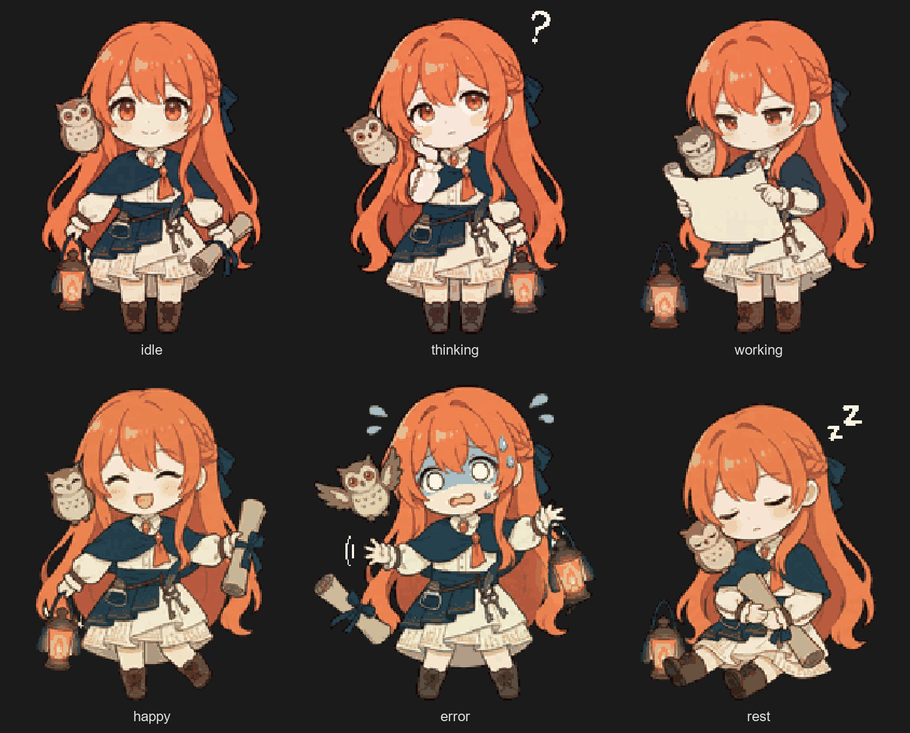
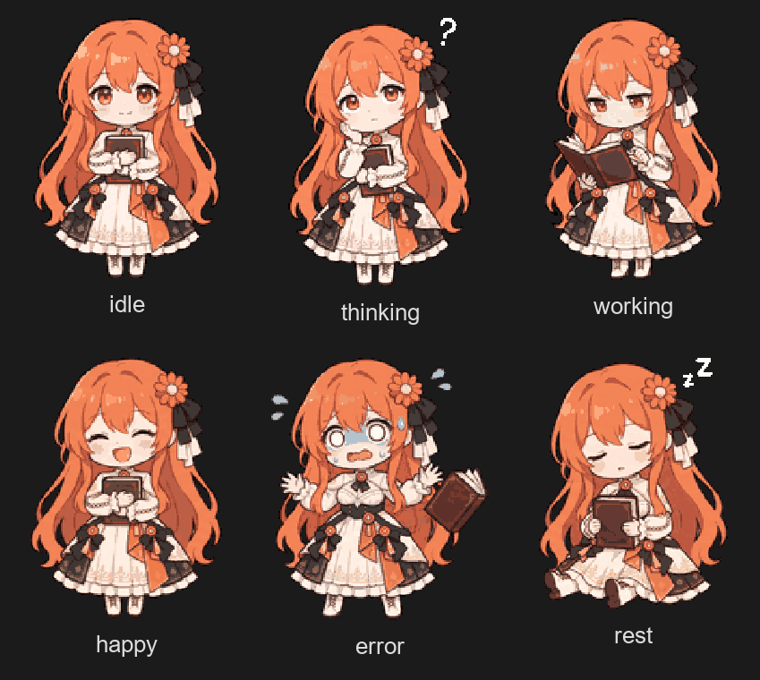

# chibi-theme-for-claude-code

**English** · [繁體中文](README.zh-TW.md)

A chibi companion for the **Claude Code desktop app**. It sits in the bottom-right corner of the chat and changes picture with what Claude is doing.

Set **owl** (default, original):



Set **book** (derived from another creator's character, see below):



| State | When it shows |
| --- | --- |
| idle | on start, after an interrupt, after a turn that had an error |
| thinking | right after you send a prompt |
| working | while Claude runs a tool |
| happy | a turn finished without errors (6 s, then back to idle) |
| error | a tool failed or was denied |
| rest | idle for 5 minutes |

## Install

At the prompt of a terminal session:

```
/plugin install chibi-theme-for-claude-code --marketplace UNKNOWNREM/chibi-theme-for-claude-code
```

From a shell:

```bash
claude plugin install chibi-theme-for-claude-code --marketplace UNKNOWNREM/chibi-theme-for-claude-code
```

In the desktop app, where `/plugin` does not run: click **+** next to the prompt box, then **Plugins**, **Add marketplace** with `UNKNOWNREM/chibi-theme-for-claude-code`, then **Add plugin**.

## Use

- `/chibi` or `/chibi on` — turn it on (it also turns on at the start of each session)
- `/chibi off` — turn it off for this session
- `/chibi set owl` or `/chibi set book` — pick the picture set (remembered across sessions)
- `/chibi demo` — cycle through all six pictures every 3.5 s; `/chibi on` ends the preview

## Notes

- It draws only in the desktop app. A session has one theme at a time, so it replaces any other backdrop mod's theme.
- It reacts to events only (prompt sent, tool run, turn finished). It does not read your prompt text, makes no network requests, starts no processes and reads no files of yours. The only thing it keeps is the picture set you chose, in the plugin's own small settings store.
- Each picture is a pixel-vector drawing embedded in the SVG, because the desktop app does not load images inside an SVG. The pictures are small and blocky by design.
- Two sets of six pictures. **owl** is original AI-generated artwork by the author (MIT). **book** is AI-generated from a character illustration by ZipZipPipe ([original](https://www.bilibili.com/opus/1239937623660691478)), via a setting sheet submitted by Ninon ([#124](https://github.com/lmy414/ai-girl-stickers/issues/124)); the archive lists its license status as unknown, and it is **not** covered by the MIT license. See `NOTICE.md`.

## License

[MIT](LICENSE)
