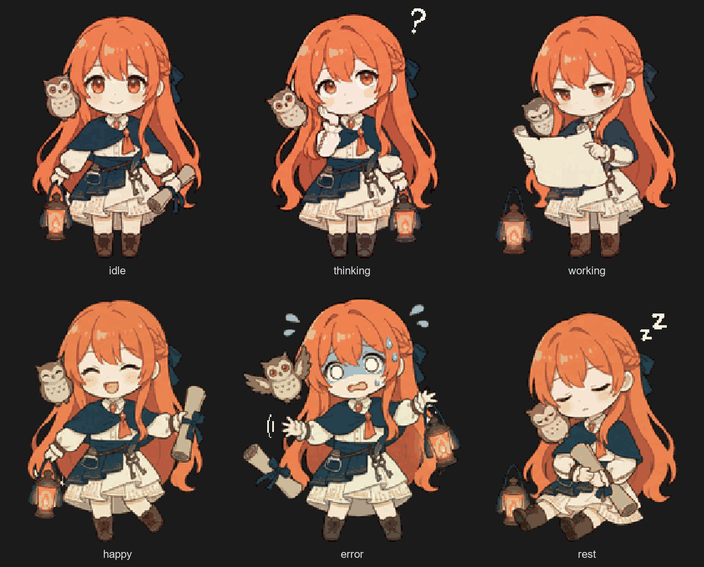
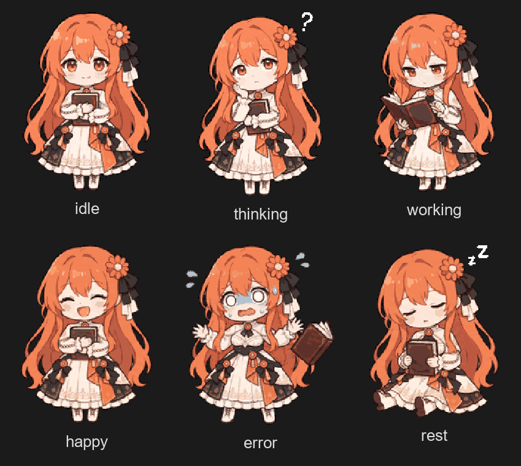

# chibi-theme-for-claude-code

[English](README.md) · **繁體中文**

Claude Code **桌面版**的 Q 版小人：固定在聊天畫面右下角，依 Claude 正在做的事自動換圖。

圖組 **owl**（預設，原創）：



圖組 **book**（衍生自他人角色，見下方說明）：



| 狀態 | 何時顯示 |
| --- | --- |
| 待機 | 開啟時、被中斷時、整個回合有出錯之後 |
| 思考中 | 你送出提問之後 |
| 工作中 | Claude 執行工具時 |
| 開心 | 回合順利結束（顯示 6 秒後回到待機） |
| 出錯 | 工具失敗或被拒絕 |
| 休息 | 待機超過 5 分鐘 |

### 安裝

終端機工作階段的提示列：

```
/plugin install chibi-theme-for-claude-code --marketplace UNKNOWNREM/chibi-theme-for-claude-code
```

在 shell 裡：

```bash
claude plugin install chibi-theme-for-claude-code --marketplace UNKNOWNREM/chibi-theme-for-claude-code
```

桌面版不能執行 `/plugin`：點提示框旁的 **+**，選 **Plugins**，**Add marketplace** 填入 `UNKNOWNREM/chibi-theme-for-claude-code`，再按 **Add plugin**。

### 使用

- `/chibi` 或 `/chibi on`：開啟（每個新工作階段開始時也會自動開啟）
- `/chibi off`：在這個工作階段關閉
- `/chibi set owl` 或 `/chibi set book`：選圖組（下次開啟也會沿用）
- `/chibi demo`：每 3.5 秒輪流顯示六張圖；`/chibi on` 結束預覽

### 注意

- 只在桌面版繪製。一個工作階段同時只有一個主題，所以會取代其他背景類 mod 的主題。
- 只依事件反應（送出提問、執行工具、回合結束），不讀你的提問文字，不發網路請求、不啟動程序、不讀你的檔案。唯一保存的是你選的圖組，存在外掛自己的小設定檔裡。
- 每張圖都是內嵌在 SVG 裡的像素向量圖，因為桌面版不會載入 SVG 內的圖片，所以畫面刻意是小而有方塊感的風格。
- 內含兩組各六張圖。**owl** 是作者自行以 AI 生成的原創作品（MIT）。**book** 是以 ZipZipPipe 的角色立繪為參考、由 AI 生成（[原作](https://www.bilibili.com/opus/1239937623660691478)），實際參考的是 Ninon 投稿的設定圖（[#124](https://github.com/lmy414/ai-girl-stickers/issues/124)）；存檔標註其授權狀態為「不明」，**不在** MIT 授權範圍內，詳見 `NOTICE.md`。

## 授權

[MIT](LICENSE)
